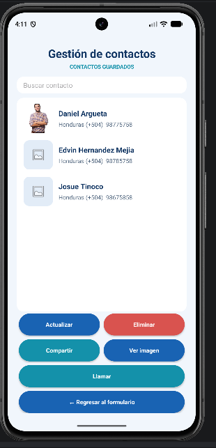
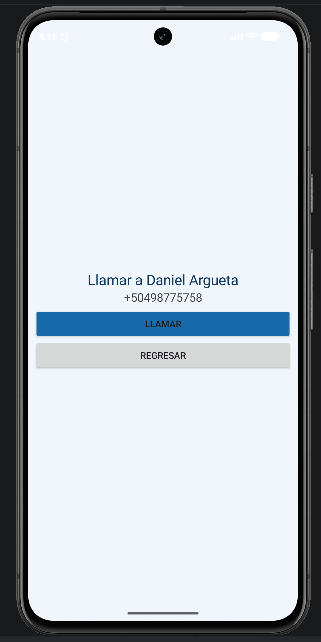
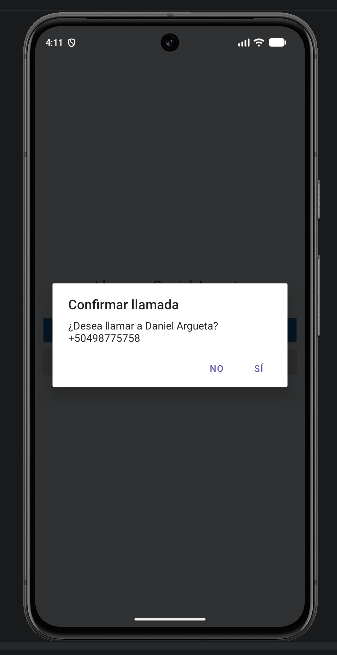

# Aplicación de registro y gestión de contactos

## Información del estudiante

- **Nombre completo:** Edvin Josue Hernandez Tinoco
- **Número de cuenta:** 119140044
- **Proyecto:** PM01Examen119140044
- **Materia:** Programación de aplicaciones móviles

## Descripción

Aplicación móvil desarrollada en Android Studio para registrar y gestionar contactos utilizando SQLite.

Funciones principales:
- Registrar contactos.
- Guardar fotografías.
- Buscar contactos.
- Actualizar y eliminar contactos.
- Compartir información.
- Ver fotografías guardadas.
- Realizar llamadas.

- ## Capturas de pantalla

### 1. Formulario de registro

### 2. Lista de contactos

### 3. Pantalla de llamada

